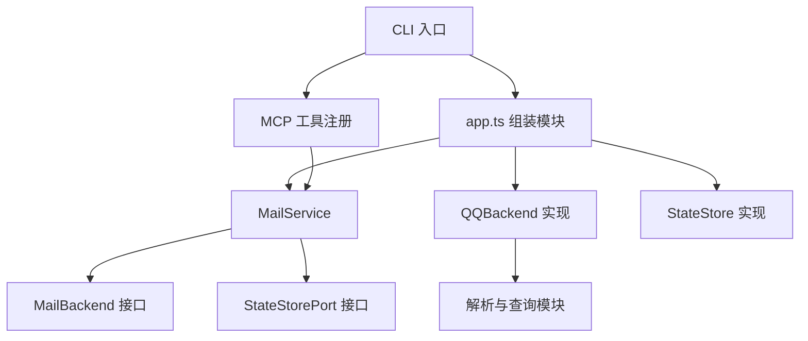

# 架构说明

## 模块边界

入口位于 `src/cli`。`serve.ts` 启动 stdio 与退出处理；`check.ts` 输出连接状态；`read-mail.ts` 通过 MCP 调用只读工具。导入 `src/mcp/server.ts` 或 `src/app.ts` 不会启动进程、连接邮箱或执行命令。

`app.ts` 是统一的组装入口：读取环境变量，创建 QQ 后端和文件状态存储，再构造 `MailService`。测试可注入后端及状态存储，不需要真实邮箱凭据。

`mcp/server.ts` 注册八个工具，`mcp/schemas.ts` 定义参数；这两者处理协议层输入输出。`mail/service.ts` 处理草稿、预览、确认参数、内容版本和重复发送规则，依赖 `MailBackend` 与 `StateStorePort` 接口。

`mail/qq-backend.ts` 使用 ImapFlow/Nodemailer 执行协议操作；`parser.ts` 解析 MIME 与 HTML；`search.ts` 转换查询并处理分页；`identity.ts` 生成稳定的邮件标识和预览哈希。

`storage/state-store.ts` 负责状态读取、原子写入和跨进程锁。`config/env.ts` 只读取和校验两个环境变量；`config/paths.ts` 集中确定项目路径、构建入口、版本和账户数据路径。

## 调用方向

## 兼容性

0.3.0 保持 0.2.0 的工具名称、输入 JSON Schema 和审批提示。预览令牌生命周期、消息引用字段、账户哈希、草稿哈希和持久化状态版本 1 均保持一致。回归测试使用 0.2.0 导出的契约和合成状态样本验证兼容性。

用户确认由 Codex 对话与工具审批执行；`userConfirmed` 参数不是独立的人类身份认证。服务器另行检查预览令牌、内容未变、收件信息和发送尝试记录。

## 构建与部署

构建先清理经过路径检查的本项目 `dist` 目录，再运行 TypeScript 编译器，防止旧入口残留。

打包按固定白名单复制源码、编译产物、文档、技能、测试和安装脚本，安装生产依赖；不复制个人工作目录。安装器使用独立运行时目录，仅在副本中写入 Node 可执行文件路径，源码 `mcp.json` 始终可移植。

没有引入新的测试框架、依赖注入框架或额外服务进程。模型推理仍由 Codex 完成。
